<div align="center">

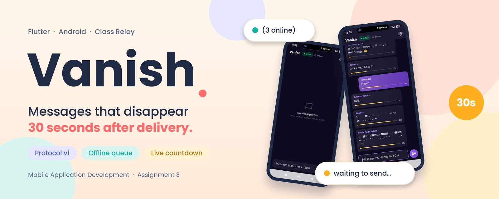

<br/>


**Vanish Class Network** is a chat app. Every message disappears 30 seconds after it is delivered, on every phone that got it.
Made for *Assignment 3, Mobile Application Development* by **Muqaddas Fatima**.

<br/>

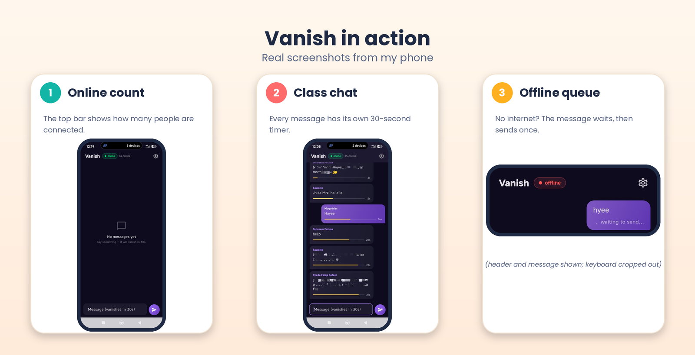

<sub>Real screenshots: online count, class chat with a timer on every message, and the offline queue.</sub>

</div>

---

## Contents

[What is Vanish?](#what-is-vanish) ·
[How it works](#how-it-works) ·
[Features](#features) ·
[The chat screen](#the-chat-screen) ·
[Message lifecycle](#message-lifecycle) ·
[Accurate countdown](#accurate-countdown) ·
[No internet](#what-if-there-is-no-internet) ·
[Protocol](#protocol-v1-summary) ·
[Project structure](#project-structure) ·
[Build and run](#build-and-run) ·
[What Vanish cannot guarantee](#what-vanish-cannot-guarantee) ·
[AI disclosure](#academic-integrity-and-ai-disclosure)

---

## What is Vanish?

Vanish is a chat app for one shared class room. All apps connect to **one class server** (called a relay) and follow **one set of shared rules** (called a protocol). This way, students using different apps can chat with each other.

- Every message has a yellow timer bar that counts down from 30 seconds.
- When time is up, the message is removed from the screen **and** from the file on the phone.
- If there is no internet, the message waits and is sent when the internet comes back.

| | |
|---|---|
| **Framework** | Flutter (Dart) |
| **Platform** | Android (tested on Android 16, POCO C75) |
| **Relay address** | `wss://vanish-relay-sawaira.bonto.page/ws` |
| **Local storage** | JSON file `vanish_state.json` (waiting messages and saved state) |

---

## How it works

My phone does not talk to other phones directly. Every phone talks to the class server. The server gives each message to everyone and deletes it after 30 seconds.

<div align="center">
  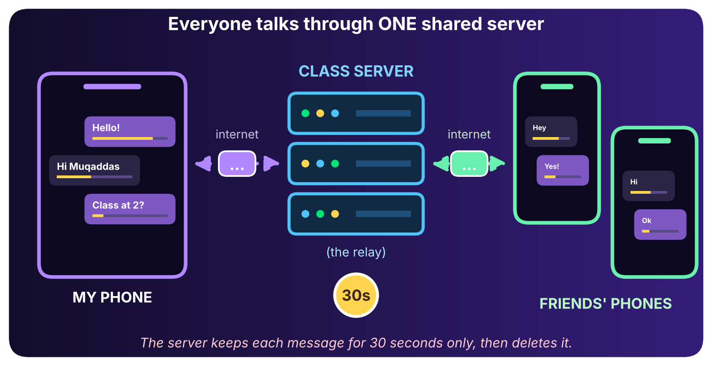
</div>

Inside the app, the screens do not use the internet or the file directly. They ask the controller, and the controller uses the protocol and storage helpers.

<div align="center">
  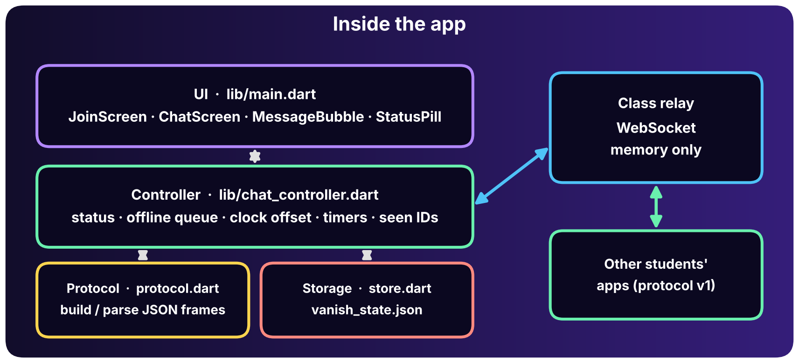
</div>

---

## Features

<div align="center">
  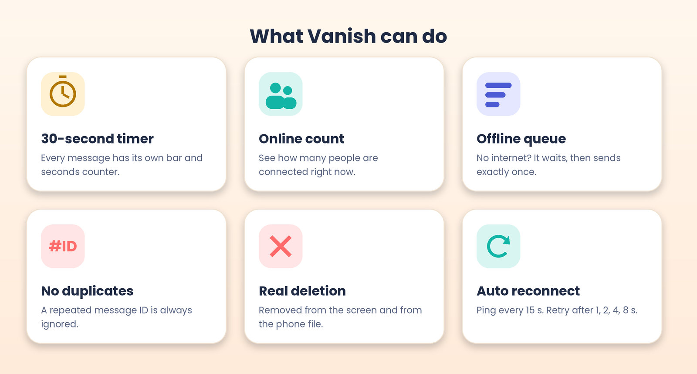
</div>

## The chat screen

<div align="center">
  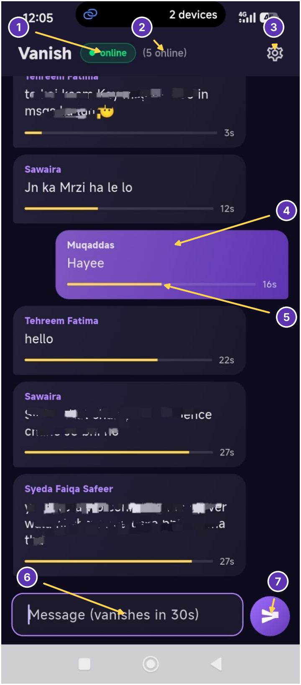
</div>

---

## Message lifecycle

<div align="center">
  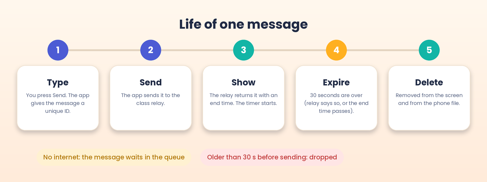
</div>

**Who decides when a message ends?** The class server. It writes a start time (`sent_at`) and an end time (`expires_at`, which is `sent_at + 30000`) on each message. The sender and the receiving phones do not decide, so nobody can keep a message alive longer.

---

## Accurate countdown

The app does not trust the phone's own clock to decide when a message ends. When the app joins (the `welcome` step), it compares the server's time with the phone's time and saves the difference as an **offset**.

```text
offset    = server_time - phone_time
remaining = (expires_at - offset) - phone_time
```

The app saves the end time (`expires_at`), not "seconds left". So the timer is still correct after the app goes to the background, is turned sideways, or is closed and opened again.

<div align="center">
  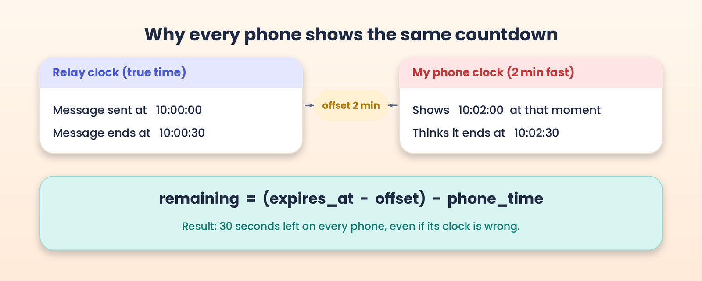
</div>

---

## What if there is no internet?

A message written with no internet waits in a queue. If more than 30 seconds pass before it can be sent, it is **thrown away and never sent**. If the internet comes back in time, it is sent exactly once and gets a new 30-second timer from the server.

<div align="center">
  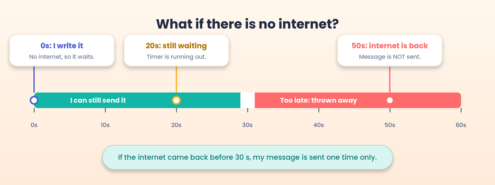
</div>

---

## Protocol v1 summary

The full rules are in [`PROTOCOL.md`](PROTOCOL.md) (written by Sawaira Waheed and agreed by the class).

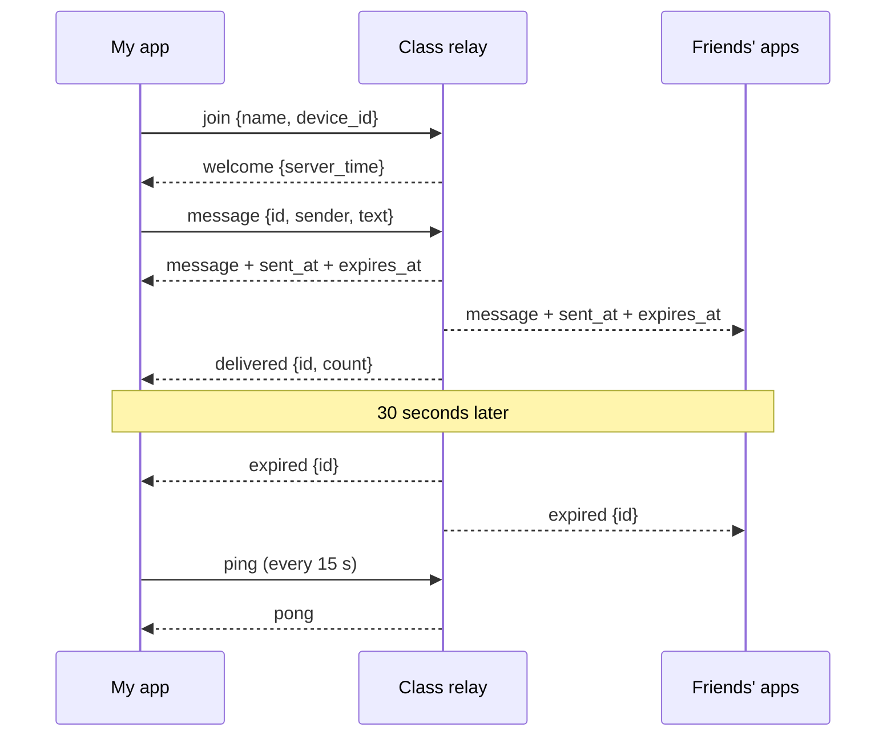


## Project structure

```text
vanish/
├── lib/
│   ├── main.dart              # screens, theme, message bubbles
│   ├── chat_controller.dart   # state, queue, clock offset, timers, reconnect
│   ├── protocol.dart          # JSON frames, relay URL, 30 s lifetime
│   ├── store.dart             # reads/writes vanish_state.json
│   └── models.dart            # message model
├── *.png                  # images used in this README (banner, showcase, diagrams)
├── PROTOCOL.md                # shared class protocol v1
└── pubspec.yaml
```

---

## Build and run

```bash
git clone https://github.com/Umer048/vanish.git
cd vanish
flutter pub get
flutter run                 # run on a connected phone or emulator
flutter build apk --release # make an installable APK
```

1. Install the Flutter SDK and open the project in Android Studio.
2. Connect an Android phone or start an emulator.
3. Type a display name and press **Enter Vanish**.
4. The default relay is `wss://vanish-relay-sawaira.bonto.page/ws`. You can change it with the gear icon.

> The free relay host goes to sleep when nobody uses it, so the first connection after a break can take up to a minute.

### Quick demo checklist

- [ ] Send a message from two phones and compare the countdowns.
- [ ] Turn the internet off, send a message, then turn it on again (it must arrive once).
- [ ] Close and open the app during a countdown.
- [ ] Check that `vanish_state.json` does not contain a message that has ended.

---

## What Vanish cannot guarantee

"Messages vanish in 30 seconds" only works for apps that follow the protocol. Once a message leaves the sender's phone, no app can control what happens to it.

<div align="center">
  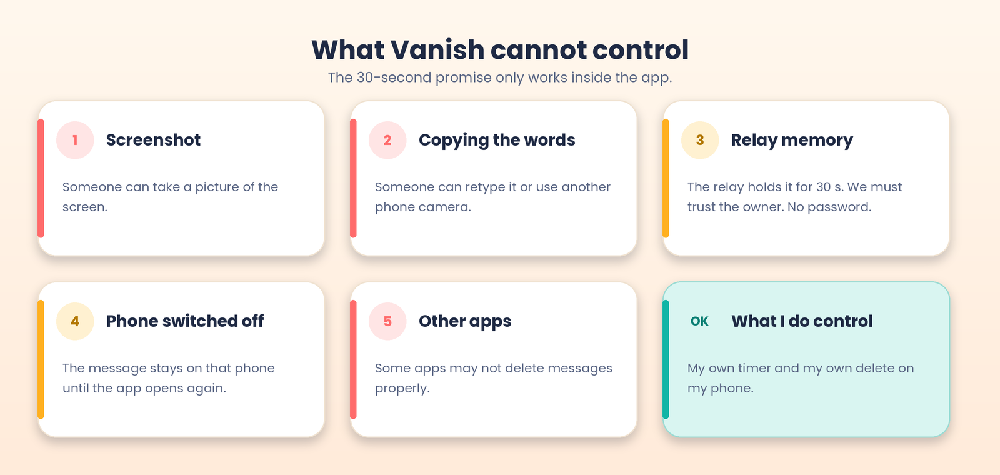
</div>

- **Screenshots** and **copying the words** cannot be stopped.
- **Relay memory:** the server keeps messages for 30 seconds, and we have to trust the person who runs it. It has no password.
- **A phone that is switched off** when a message ends keeps the message until the app is opened again.
- **Other apps** may not delete messages properly.
- **Dropped offline messages:** a waiting message older than 30 seconds is never sent, so the sender may think it was sent.

---

## Academic integrity and AI disclosure

- **AI tools:** I used AI help for code cleanup, fixing Flutter warnings (`withOpacity`), and understanding the WebSocket rules.
- **Class work:** the protocol document (`PROTOCOL.md`) was written by Sawaira Waheed and agreed by the class. I did not change the protocol myself.

---
